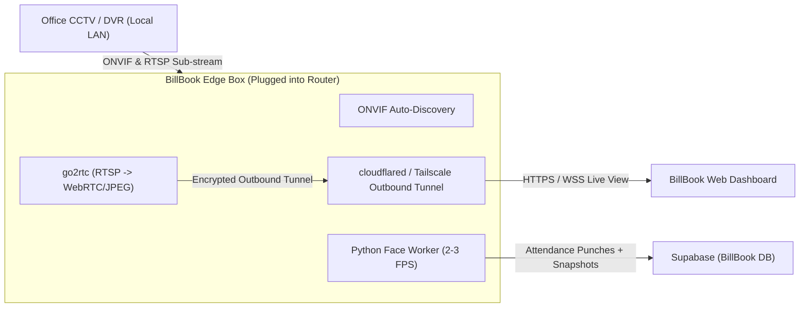

# BillBook Plug-and-Play CCTV Edge Box Blueprint

This blueprint lets you build a **zero-config hardware box** that you can ship to any customer. They plug it into power and their office router, enter their `BOX_ID` and camera login inside BillBook, and get instant live CCTV monitoring + automated facial attendance—with **no port forwarding, no CGNAT issues, and no software installed on their PCs**.

---

## 1. Architecture Overview

---

## 2. Hardware Bill of Materials (Per Unit)

| Component | Recommended Spec | Approx. Cost (INR) | Notes |
|---|---|---|---|
| **Compute Unit** | **Refurbished Intel Mini-PC** (i3/N100, 8GB RAM, 128GB SSD) *or* **Raspberry Pi 4/5 (4GB+)** | ₹5,500 – ₹8,500 | x86 Mini-PC is faster for multi-camera face recognition; Pi 4/5 is smaller & fanless-friendly. |
| **Storage** | 128GB SSD (Mini-PC) or 32GB High-Endurance MicroSD (Pi) | Included / ₹700 | Use high-endurance cards if using a Pi. |
| **Network** | Cat6 Ethernet Patch Cable (1m) | ₹150 | Always wire to the router via Ethernet (not Wi-Fi) for stable RTSP. |
| **Power** | Official PSU (12V for Mini-PC / 5V 3A USB-C for Pi) | Included / ₹600 | Enable **"Auto Power-On after AC Loss"** in BIOS so it boots automatically after power cuts. |
| **Label** | Printed sticker with `BOX_ID` & Setup QR Code | ₹20 | Links the physical box to the customer's BillBook workspace. |

---

## 3. Software Stack (Pre-Flashed Master Image)

Flash **Ubuntu Server 24.04 LTS** (or Raspberry Pi OS Lite 64-bit) once, install **Docker + Docker Compose**, and clone this image for every box you ship.

### Services Running on the Box (`docker-compose.yml`)
1. **`go2rtc` (Official Docker Image `alexxit/go2rtc`)**
   - Converts local DVR/camera RTSP streams into browser-ready **WebRTC / MSE / HLS** and snapshots.
   - Zero Python/FFmpeg build issues.
2. **`billbook-worker` (Your Python Face & Discovery Service)**
   - Runs `discovery.py` (ONVIF WS-Discovery to auto-find DVRs/cameras on the LAN) + `tracker.py` (OpenCV + face recognition at 2–3 FPS on the low-bandwidth sub-stream).
   - Posts matched employee punches directly to BillBook's Supabase `attendance_records` table.
3. **`cloudflared` (Cloudflare Tunnel) or `tailscale`**
   - Opens an **outbound encrypted tunnel** from the office LAN to your BillBook cloud domain.
   - Bypasses CGNAT, dynamic IPs, and router port-forwarding completely.
4. **`watchtower` (`containrrr/watchtower`)**
   - Automatically pulls your updated Docker images whenever you push a bugfix or feature update—so you never need to touch deployed boxes.

---

## 4. Zero-Touch Customer Onboarding Flow ("Just Enter Camera Login")

1. **Unbox & Plug In:** Customer plugs the Edge Box into their office router (Ethernet) and a power socket.
2. **Auto-Connect:** Within 30 seconds, the box boots, establishes its outbound tunnel, and heartbeats to BillBook with its `BOX_ID`.
3. **Claim & Scan in BillBook:**
   - Customer opens **BillBook → Payroll → Attendance → Cameras → Add Edge Box** and enters the `BOX_ID` printed on the sticker (or scans the sticker QR).
   - Customer clicks **"Scan Office Cameras"** → the box runs ONVIF discovery on the local LAN and lists the DVR/cameras automatically.
4. **Enter Camera Credentials:** Customer types their DVR/camera **Username & Password** and selects which channels are entrance cameras.
5. **Live:** `go2rtc` and the Python face worker start immediately—the admin sees live camera feeds in BillBook and employee punches flow into payroll automatically.
